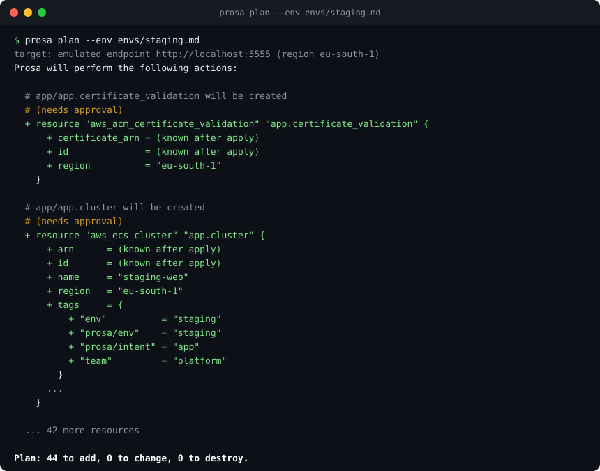

# Prosa

**Infrastructure written in prose.** A folder of prompts is the desired state of your cloud and your on-premises estate; an engine reconciles it continuously against the provider APIs, without generating code. Terraform/OpenTofu providers are the drivers; Claude (or any OpenAI-compatible model) plans, and every change goes through a provider-computed plan, policy and your approval.

[](https://github.com/giammbo/prosa/actions/workflows/ci.yml)
[](https://github.com/giammbo/prosa/releases)
[](LICENSE)
[](go.mod)



> **Status: early.** Everything is tested against **Moto** (an AWS emulator), with simulated model conversations. The run on **real AWS** is prepared (`demo/aws/`) but has **not been executed yet**, and the planner has not been recorded against the real model. Do not point it at an account you care about.

## Install

No need to clone the repo. On linux or macOS (amd64 or arm64), the install script downloads the latest release, verifies its checksum and puts `prosa` in `/usr/local/bin` (or `~/.local/bin` if that is not writable):

```sh
curl -fsSL https://raw.githubusercontent.com/giammbo/prosa/main/install.sh | sh
```

`PROSA_VERSION=v0.1.0` installs a specific release, `PROSA_INSTALL_DIR=~/bin` picks the folder. By hand: download `prosa_<version>_<os>_<arch>.tar.gz` and `checksums.txt` from the [Releases](https://github.com/giammbo/prosa/releases) page, check the archive, extract `prosa` and put it on your `PATH`:

```sh
curl -fsSLO https://github.com/giammbo/prosa/releases/download/v0.1.0/prosa_0.1.0_darwin_arm64.tar.gz
tar -xzf prosa_0.1.0_darwin_arm64.tar.gz prosa && sudo mv prosa /usr/local/bin/
```

With Go:

```sh
go install github.com/giammbo/prosa/cmd/prosa@latest
```

Check it with `prosa version`. The environment variables are listed in [`.env.example`](.env.example).

Argo CD syncs manifests. Terraform applies HCL. Prosa syncs intentions.

```
acme/                 the project: one folder, commands are run from here
  app.md              "The web app from image X, exposed on Y with TLS, two replicas, ..."
  database.md         "A 20 Gi Postgres with nightly backups, encrypted, ..."
  cron.md             "Every night at 3am clean up sessions older than 30 days ..."
  envs/
    staging.md        "For staging 40 GB and Postgres 18": the differences, in prose (you write it)
    prod.md
    staging.lock.yaml the environment's frozen concrete choices: the patch on the base, names, IDs (generated, do not edit)
  prosa.lock.yaml     the base lock (generated, do not edit)
```

The intents in the root (every `.md` except `README.md`) are the **base**; an environment is a prose file passed with `--env` (`prosa plan --env envs/staging.md`) that wins over the base where they disagree, like a Terraform workspace with its `-var-file` (ADR-029). There is no `prosa.yaml`: account and region are the ones of the AWS CLI.

The environment file can have sections named after an intent (`## database`): the lines under one apply only to that intent, those before the first section apply to all of them. The base is planned once (its lock lives in the root); an environment costs only a model patch on top of that base, and if the base changes but the section does not, the patch is re-applied without calling the model (ADR-030). `prosa plan` never writes a lock: `apply` does, and the first `apply --env` plans the base first. A `## X` heading that is not the name of an intent (case does not matter), nor of one that the environment lock still has and that the run removes, is a warning on stderr (`prosa: warning: …`): its lines apply to no intent and the run goes on.

Terraform/OpenTofu providers are the drivers (over gRPC, no HCL). Claude plans the desired state; the plan is computed by the provider, filtered by policy and autonomy, and destruction asks for approval. The full state of the resources lives in a client-side encrypted state store (rebuilding it from the labels on the resources is designed, not implemented: without the passphrase the store cannot be read, see below).

## Status

- **M1** provider host (registry, verified download, gRPC).
- **M2** the engine: intents, lockfile, state store, `plan`/`apply`.
- **M3** the Claude planner (a tool-use loop that reads the provider schemas, cache in `.prosa/planner/`).
- **M4** templates and `depends_on`, checks (`resource_attr`, `http_get`, `tls_days`), policy and autonomy, event log, `recover`.
- **M5** demo 1 as a script (`demo/moto/run.sh`) and the preflight for a run on real AWS (`demo/aws/preflight.sh`).
- **M6** environments as prose files (ADR-029): `--env`, per-environment lock and state, region and credentials from the AWS CLI, no `prosa.yaml`.
- **M7** few tokens and any LLM (ADR-030, ADR-031): the base is planned once and an environment is a patch on it, with `## <intent>` sections in the environment file; `anthropic` or `openai` backend (local models).

Tested on **Moto** (an AWS emulator): the demo 1 script, from plan to cleanup, with the simulated desired states in `demo/fixtures.json`; the e2e tests run under the same conditions. **Not done yet:** the run on real AWS (prepared, never executed) and recording the conversations with the real model (the test conversations are simulated). Next step: the AWS run.

## Quick start on Moto

You need `go`, `docker`, `curl`, the `aws` CLI and `shasum`. No credentials: the script never touches real AWS (it clears the `AWS_*` variables, forces the endpoint and accepts only `localhost`/`127.0.0.1`).

```sh
docker compose -f e2e/compose.yaml up -d     # Moto on http://localhost:5555 (if you already have the container: docker start prosa-moto)
demo/moto/run.sh
```

The script builds `bin/prosa`, creates a temporary project by copying `examples/` (the intents and `envs/staging.md`), points at Moto with `PROSA_AWS_ENDPOINT` and the region with `PROSA_AWS_REGION`, enters the folder and walks through the demo steps with `prosa plan`, `prosa apply`, `prosa check` and `--env envs/staging.md`: plan, apply and checks; one line changes (first the check, and the plan stops on the contradiction, then the first sentence too: a single update); delete `cron.md`; three `apply` reruns with no changes (identical lock and state store); a manual change with the `aws` CLI and drift repair; cleanup. Variables:

| Variable | Effect |
|---|---|
| `DEMO_AUTO=1` | answers `yes` to approval prompts |
| `DEMO_PAUSE=1` | waits for Enter after each step (for recording the video) |
| `PROSA_PLANNER=llm` | uses Claude instead of the simulated states (default: `fixtures`): it is a full run with apply on Moto; the assertions of steps 2 and 3 (block, single change, approval) become warnings, because the model may not block or may also change `min_capacity` |
| `PROSA_MOTO_URL` | Moto address (default `http://localhost:5555`, localhost only) |
| `PROSA_AWS_PROVIDER_VERSION` | `hashicorp/aws` version written in the initial lock (default `6.69.1`) |
| `DEMO_DIR` | project folder (default: `mktemp`); if it exists it must be empty, otherwise it exits with code 2 |

## Using Claude

The planner reads Anthropic credentials from `ANTHROPIC_API_KEY` or from an `ant auth login` profile (check: `ant auth status`). The first real try is best done as planning only on Moto: `prosa plan` writes nothing, and the answers end up in the `.prosa/planner/` cache, which the next plan on AWS reuses only if you work in the same project folder.

```sh
export ANTHROPIC_API_KEY=...          # or: ant auth login
PROSA_PLANNER=llm demo/moto/run.sh    # a FULL run with apply on Moto (not planning only)
# planning only, by hand, with Moto explicit, inside a project
# (a folder with the intents and envs/staging.md; choose and keep the passphrase):
cd <project>
PROSA_AWS_ENDPOINT=http://localhost:5555 AWS_REGION=eu-south-1 PROSA_STATE_PASSPHRASE='<your passphrase>' \
  prosa plan --env envs/staging.md --require-endpoint
```

`--model` chooses the model that plans (default: the engine's, an Anthropic model) and `--patch-model` the one that writes the environment patches (default: the same). Effort: `PROSA_EFFORT` (default `high`) and `PROSA_PATCH_EFFORT` (default `low`), `low`, `medium` or `high`. `--no-cache` ignores the cache and does not write it, and also disables resuming an interrupted intent (ADR-025: it replans with the model). `--fixtures FILE` and `--model` are incompatible.

### Another model, even a local one

The planner talks to any LLM that can call functions with a JSON schema (tool calling) through the OpenAI-compatible Chat Completions API (ADR-031): frontier providers and local servers such as Ollama, vLLM, llama.cpp server, LM Studio. You choose it only with variables and flags:

| Variable | Effect |
|---|---|
| `PROSA_LLM` | `anthropic` (default, if Anthropic credentials are present) or `openai` |
| `PROSA_LLM_BASE_URL` | with `openai`, required: the API base URL (for example `http://localhost:11434/v1`) |
| `PROSA_LLM_API_KEY` | with `openai`, the key if the server wants one (local ones usually do not) |
| `PROSA_MODEL`, `PROSA_PATCH_MODEL` | like `--model` and `--patch-model` |
| `PROSA_EFFORT`, `PROSA_PATCH_EFFORT` | planning and patch effort: `low`, `medium`, `high` |
| `PROSA_SCHEMA_BYTES` | limit in bytes of the schema shown to the model (default 30720): lower it for small contexts |

With Ollama, planning only on Moto:

```sh
PROSA_AWS_ENDPOINT=http://localhost:5555 PROSA_LLM=openai PROSA_LLM_BASE_URL=http://localhost:11434/v1 \
  prosa plan --require-endpoint --model <model>
```

With `openai`, `--model` (or `PROSA_MODEL`) is required, otherwise exit 2: the default is an Anthropic model and the server does not know it. The `openai` backend does not use streaming, and prompt caching and fallbacks stay with `anthropic`. How much worse planning gets with a small model has not been measured yet.

## Commands

```
prosa init    [<dir>]
prosa plan    [--env FILE] [--ignore a.md,b.md] [--lock F] [--state D] [--fixtures F | --model M [--patch-model M]] [--no-cache] [--events F | --no-events] [--require-endpoint] [--no-color] [<dir>]
prosa apply   [--yes] ...same options as plan... [<dir>]
prosa check   [--env FILE] [--ignore a.md,b.md] [--lock F] [--state D] [--events F | --no-events] [--require-endpoint] [--no-color] [<dir>]
prosa recover [--env FILE] [--ignore a.md,b.md] [--lock F] [--state D] [--events F | --no-events] [--require-endpoint] [--no-color] [<dir>]
prosa debug schema <namespace/name>[@version] <resource_type>
```

`<dir>` is the project, by default the current folder. A leftover `prosa.yaml` in the folder is rejected (exit 2). `--env FILE` is the environment (usually `envs/<name>.md`, never in the root); `--ignore` lists the root `.md` files that are not intents (default `README.md`). Region: `PROSA_AWS_REGION`, then `AWS_REGION`, `AWS_DEFAULT_REGION`, then the profile's; `PROSA_AWS_ENDPOINT` points at an emulated AWS.

- `init`: creates the `envs/` folder and a `.gitignore` that excludes `.prosa/` (or adds the line to the existing one); it does not touch what exists.
- `plan`: computes and shows the plan (create, update, drift, destructions), without changing anything.
- `apply`: applies the plan; it asks for `yes` for the changes that policy or the autonomy level put under approval (destruction by default); `--yes` answers for you.
- `check`: runs the checks written in the intents (`pass`, `skipped`, `fail`).
- `recover`: after an interruption (Ctrl-C, crash) rebuilds the lock from the state store, for the intents whose state is ahead of the lock (and redoes it if it is missing or empty); then rerun `plan`.
- `debug schema`: prints the schema of a provider resource.

The output has the shape of Terraform, to be read at a glance:

```
  # app/app.service will be updated in-place
  # (needs approval)
  ~ resource "aws_ecs_service" "app.service" {
        id            = "arn:aws:ecs:eu-south-1:123456789012:service/staging-web/web"
      ~ desired_count = 2 -> 3
        # (19 unchanged attributes hidden)
        # (3 unchanged blocks hidden)
    }

Plan: 0 to add, 1 to change, 0 to destroy.
app/app.service: Modifying... [id=arn:aws:ecs:eu-south-1:123456789012:service/staging-web/web]
app/app.service: Modifications complete after 0s [id=arn:aws:ecs:eu-south-1:123456789012:service/staging-web/web]
Apply complete! Resources: 0 added, 1 changed, 0 destroyed.
```

Gates and drift are comments under the heading (`# (needs approval: destroy)`, `# (drifted outside Prosa: allocated_storage)`); sensitive values are `(sensitive value)`. Colors appear only on a terminal and are turned off with `--no-color` or `NO_COLOR`.

Exit codes: 0 ok, 1 error, 2 wrong usage. A second Ctrl-C forces the exit (code 130) and the resource in progress may exist on the cloud without being recorded: `recover` does not find it, look for it by tag `prosa/intent`.

## Files, state and security

Everything lives in the project `<dir>`. With `--env envs/<name>.md` (ADR-029) lock, state and events belong to the environment; without it, the base paths apply.

| Path | What |
|---|---|
| `<dir>/envs/<name>.md` | the environment file (you write it, it is committed) |
| `<dir>/envs/<name>.lock.yaml` | the environment lockfile, next to its file (`--lock`; committed) |
| `<dir>/.prosa/state.d/<name>/` | the environment's encrypted state store (`--state`) |
| `<dir>/.prosa/events/<name>.jsonl` | JSON Lines event log, 0600, append-only (`--events`, `--no-events`) |
| `<dir>/.prosa/planner` | planner cache, shared across environments |
| `<dir>/.prosa/base/<intent>.md` | the text each intent's base was planned from (ADR-030) |
| `<dir>/prosa.lock.yaml`, `.prosa/state`, `.prosa/events.jsonl` | the same, without `--env` |

The engine adds the `prosa/intent` tag to every resource and, with `--env`, `prosa/env=<name>`. No secrets in the project: the passphrase and the Anthropic key stay in the shell environment.

- **Where it points.** Every reconciliation command (`plan`/`apply`/`check`/`recover`) writes a `target:` line to stderr: the emulated endpoint from `PROSA_AWS_ENDPOINT` (`target: emulated endpoint http://localhost:5555 (region eu-south-1)`), or AWS (`target: AWS account from current credentials (region eu-south-1)`). Prosa does not check the account: if it is the wrong one you see it from the plan.
- **Never AWS by mistake.** `--require-endpoint` (or `PROSA_REQUIRE_ENDPOINT=1`) refuses to start without `PROSA_AWS_ENDPOINT` (exit 2).
- **Approvals.** The plan is mandatory; destruction asks for approval by default. Policy and autonomy are declared in the intents (ADR-022).
- **Events without values.** The log reports actions, drifted attributes, approvals, tokens; never attribute values (ADR-023).
- **Passphrase.** `PROSA_STATE_PASSPHRASE` encrypts the state store and is required. **If you lose it, the resources are left orphaned** (prosa can no longer read or destroy them): save it in a password manager before the first `apply`.

## Layout

`cmd/prosa` is the CLI, `internal/` the engine, planner, provider host, lock and state store, `e2e/` the tests against Moto. Design notes are maintained privately. The example project is `examples/`, the one adapted for real AWS is `demo/aws/project/` (base plus `envs/staging.md`).

Tests: `go test ./... && go vet ./...` (offline); e2e against Moto: `PROSA_E2E=1 go test ./e2e/ -count=1 -timeout 50m`.
